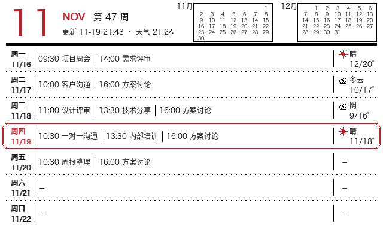

# 7.5 寸墨水屏 · 周视图（交付说明）

ESP32 + 三色墨水屏的桌面周历：每行一天，右侧天气，右上角小月历，支持本周/下周切换、按键操作与电量显示。
原厂只发布了编译好的 `.bin`，本工程是从零重写的固件 + 一套可直接跑的取数链路。

> 状态：**已实机跑通**。天气、企微日程、电量、四个按键、周切换、配网全部验证过。

---

## 1. 硬件

| 部件 | 说明 |
|---|---|
| 主控 | ESP32（8MB flash） |
| 屏幕 | 三色墨水屏，逻辑画布 **640×384**（`SCR_W/SCR_H`，与 `display.width()/height()` 一致） |
| 串口 | CH340，`/dev/cu.usbserial-XXXX`，**烧录必须 115200**（921600 校验阶段会失败） |
| 电池 | 单节锂电；USB 口同时供电 + 充电 + 串口 |

**屏幕引脚**（GxEPD2 示例口径）

| 信号 | GPIO |
|---|---|
| CS | 5 |
| DC | 19 |
| RST | 16 |
| BUSY | 17 |
| SCK | 18 |
| MOSI | 23 |

MISO 未接（墨水屏只写），代码传 `-1`，避免与 DC 抢 19 号脚。

**按键（逐键实测，不可凭丝印猜）**

| 位置 | 连接 | 性质 |
|---|---|---|
| 1 号（最上） | EN | 硬件复位，按下即重启，无 GPIO 事件，固件无法接管 |
| 2 号 | GPIO34 | 普通键，外部上拉，按下为低 |
| 3 号 | GPIO35 | 同上 |
| 4 号（最下） | GPIO39 | 同上；深睡期间作为 ext0 唤醒源 |

34/35/39 都是 input-only，**没有内部上拉**，只能 `pinMode(INPUT)`；写 `INPUT_PULLUP` 会打印 `GPIO number error`。

**电池采样（实测定位，容易踩空）**

| 角色 | 引脚 | 说明 |
|---|---|---|
| 分压使能 | GPIO25 | 拉高才通电，平时必须拉低，否则分压电阻持续漏电 |
| 电池 ADC | GPIO36 | 2:1 分压，使能后读数 ×2 = 电池电压 |

采样流程：拉高 25 → 等 20ms → 采 8 次 GPIO36 取平均 → 立刻拉低 25。
参考读数：USB 充电中约 **2126mV → 4254mV**；门控关闭时固定在 142mV（判别"没接电池"）。

---

## 2. 按键功能

| 按键 | 操作 | 行为 |
|---|---|---|
| 1 号 | 按下 | 硬复位（硬件行为） |
| 2 号 | 短按 | 立即刷新：重新取数并强制重绘 |
| 3 号 | 短按 | 切换 **本周 ⇄ 下周**（状态存 NVS，切换后立即取数重绘） |
| 4 号 | 短按 | 仅唤醒设备，不做其他动作 |
| 4 号 | 按住 5 秒 | 进入设备信息页；再按住 5 秒退出 |
| 4 号 | 按住 30 秒 | 进入配网（热点 `MyWIFI-Station`） |

实现要点（`keys.h`）：

- 25ms 去抖；短按 <1.5s；5s / 30s 两个长按阈值可先后触发
- **唤醒那一下不算长按**：上电/唤醒时已按住的键必须先松手才参与判定，否则按 4 叫醒会被误判成长按进配网
- **阻塞动作后必须 `keysReArm()`**：取数要 1–2 分钟，若不复位计时，"按 5 秒退出信息页"会连带取数时长一起被算成按住 30 秒，直接跳进配网（真实踩过）

---

## 3. 屏幕版式（`SCR_W=640 / SCR_H=384`）



> 上图由 `tools/render_final.py` 按固件坐标生成：位置、线宽、行高与固件一致；
> 文字用系统字体近似（实机是 1bit 点阵），所以字形会略有差异，版式不会。

```
y=0   ┌ 表头：红色大月份 + 月份缩写 + 第 N 周 + 更新时间 · 天气时间
y=72  ├ 电量条（4px 高，x=10–629）
y=76  ├ 周一  ┐
      │  ...  ├ 7 行，行高 43，分隔虚线在 119/162/205/248/291/334
y=377 └ 周日  ┘
```

**顶部电量条**：整条即电量指示器，总宽 620px、高 4px（1px 边框 + 2px 空心 + 1px 边框）。
有电部分实心黑，消耗部分从**右侧**开始变成"白底黑框"。电量变化 ≥5% 才触发重绘（NVS `batDraw`）。

**今天的高亮红框**：`y = 76 + 43×i`，高 44（含下边沿压住下一行虚线）。

- 非周一时，上下边沿都正好落在分隔虚线上
- **周一时顶边在 76**，紧贴电量条底缘（75），不重叠——所以电量条不能占到 77
- 红框在整屏最后绘制，避免被下一行的虚线覆盖

**垂直居中**（行中心 `y+21.5`）

| 元素 | 位置 |
|---|---|
| 周几 / 日期 | 基线 y+19 / y+36 |
| 日程单行 | 基线 y+27 |
| 日程两行 | 基线 y+18 / y+36（行距 18px） |
| 天气图标 | y+7 起（14px） |
| 天气文字 / 温度 | 基线 y+19 / y+36 |

**列宽**：日期列到 `x=56` 为止（分割线），日程从 `x=64` 起、可用宽 479px，天气列 `x=566` 起。
日程按"时间+标题"实际像素宽做贪心装箱，最多两行，溢出显示 `+N`。

**小月历**：两块月份框，第二块右边框精确落在 `x=629`，与电量条右端平齐。

**信息页**（4 号键 5 秒）：Wi-Fi/IP/信号、上次取数、日程条数、连败次数、电量与电压、空闲内存、当前视图、按键说明。
每次从信息页退出或进入配网，都会把内容指纹清零，保证下一轮必定重画周历（否则会永远停在信息页/配网页）。

---

## 4. 数据链路

两种模式，配网页里选：

**A. 设备直连（默认，推荐）**

```
企微 CalDAV ─┐
             ├─ HTTPS（校验证书）─► 墨水屏自己解析
Open-Meteo ──┘
```

**B. 桥接服务**（`bridge/bridge.py`，`GET /api/week` 返回 JSON）——协议复杂度放在 Python 里，改逻辑不用重烧。

### 企微 CalDAV 的坑（重要）

- `calendar-query` 的 time-range **基本忽略 end，只看 start**，且 start 落在未来直接返回 0 条
- 实测：`start=11/17` 能拿到 11/25 的单次日程，`start=11/18` 就丢；`start=11/01` 返回全量
- 因此查询起点取 **所看那一周的周一往前 8 天**（永远落在过去，且能覆盖整周 + 下周一），本地再按目标周筛选
  - 踩过的坑：曾用"今天-3 天"做起点，周日查询时起点变成周四，周一~周三的日程整片消失
- REPORT 只返回资源列表 + etag，正文必须逐条 GET；**multiget 一律 403，已删除该分支**
- GET 失败会隔 300ms 重试一次，请求之间留 30ms 间隔，避免连续握手把服务器惹毛
- 上限：`hrefs[32]`、`MAX_RAW_EVENTS=72`、单轮取数预算 130 秒

### 天气

Open-Meteo，`forecast_days=15&past_days=7`（8 天覆盖不到"下周"）。
2 小时内复用 NVS 缓存，避免每次醒来都花 11 秒射频。

### 缓存分槽

本周与下周的天气/日程缓存分开存（`wxc/calc` 与 `wxc1/calc1`），否则来回切换会把对方日期冲掉。

---

## 5. 刷新与休眠

- 每 **30 分钟**（对齐半点）唤醒一次：NTP 对时 → 天气 → 日程 → 算指纹 → **内容变了才刷屏**
- 三色全刷约 20 秒且会闪，所以"内容没变就跳过"是省电与体验的关键
- 数据超过 **120 分钟**未重画则强制刷一次，避免时钟/日期漂移
- 取数失败按 5 分钟退避，连续 3 次失败后改为 30 分钟
- 深睡同时挂 **timer** 与 **ext0(GPIO39, 低电平)**，按 4 号键可提前唤醒
- **按键唤醒不自动取数**：直接开 90 秒操作窗口（定时唤醒给 12 秒）。原因是一醒来就闷头拉 1–2 分钟数据，期间按键全被吞掉，表现为"按了没反应"
- 换固件/改版式后屏幕内容可能与指纹不符，用 `RENDER_EPOCH` 强制重画一次（当前值 8，改版式时 +1）

---

## 6. 配网

1. 长按 4 号键 **30 秒**（或配置缺失时自动进入）
2. 手机连热点 **MyWIFI-Station**（无密码）
3. 浏览器打开 **192.168.4.1**
4. 填 Wi-Fi 名称/密码；直连模式还需企微邮箱、日历密码、经纬度
5. 保存后设备自动重启

日历密码获取：企微 App → 工作台 → 日程 → 右上角「三」→ 同步至其他日历。
**该密码一次性生成，重新获取会让旧的立即失效**，之后设备会 401，需要重新配网。

---

## 7. 编译与烧录

```bash
arduino-cli lib install "GxEPD2"
arduino-cli lib install "U8g2_for_Adafruit_GFX"
arduino-cli lib install "ArduinoJson"

./build.sh compile
./build.sh upload /dev/cu.usbserial-XXXX
```

等价的手工命令（**必须指定 8MB + 3MB app 分区**，默认 1.2MB 装不下中文点阵）：

```bash
FQBN="esp32:esp32:esp32:FlashSize=8M,PartitionScheme=default_8MB"
arduino-cli compile --fqbn "$FQBN" --warnings all firmware/epaper_week
arduino-cli upload  --fqbn "$FQBN,UploadSpeed=115200" -p /dev/cu.usbserial-XXXX firmware/epaper_week
```

`dist/` 下有当前版本的构建产物（含整包 `epaper_week.ino.merged.bin`，用 flash_download_tool 写 0x0 即可）。

> **没装 Rosetta 的 Mac**：Arduino 自带 ctags 是 x86 程序，会报 `bad CPU type`。
> 本工程函数都在使用前定义，可换成空脚本绕过：
> `printf '#!/bin/sh\nexit 0\n' > ~/Library/Arduino15/packages/builtin/tools/ctags/5.8-arduino11/ctags && chmod +x`

---

## 8. 目录

```
firmware/epaper_week/     固件
    epaper_week.ino       主流程、版式、信息页、配网
    keys.h                按键状态机（去抖/长按/计时重置）
    net_direct.h          直连取数：CalDAV + Open-Meteo
    ics.h                 ICS 解析与 RRULE 展开
    model.h               页面数据模型
    ca_certs.h            CalDAV / Open-Meteo 根证书
    wkfont.h              固定文案点阵
    font_*.h              大号数字、拉丁字母、正文汉字
bridge/bridge.py          可选：桥接服务
tools/mkfont.py           TTF → 1bit 点阵
tools/key_read.py         复位 + 抓串口（烧录后调试必备）
tools/serial_dump.py      纯被动抓串口，不打断设备运行
tools/nvs_dump/           NVS 体检：列出所有命名空间/键/类型
tools/bat_rec/            离线记录 ADC（拔掉 USB 后仍记录，用于定位采样脚）
tools/render_final.py     按固件坐标渲染版式定版图
preview/                  定版图（week_view_final.png）
dist/                     构建产物（含 8MB 整包 merged.bin）
```

### 串口调试的坑

`arduino-cli monitor` 会拉低 DTR → IO0 被拉低 → 芯片复位后停在 `boot:0x3 DOWNLOAD_BOOT`，表现为**串口一个字都没有**，很容易误判成固件坏了。

正确做法是用 `tools/key_read.py`：打开端口后 `dtr=False`，再 `rts` 脉冲复位，芯片才会正常 `boot:0x13 SPI_FAST_FLASH_BOOT`。
只想看日志、不想打扰设备时用 `tools/serial_dump.py`（不碰 DTR/RTS）。

---

## 9. 已知限制

- **部分办公/访客网络会拦 443**（TCP 被 RST），设备在这种网络下只能吃缓存，会一直显示旧数据
- **硬复位期间可能丢 NVS 配置**：按键测试时多次按 1 号硬复位，曾把 `wk` 里的 ssid/密码打丢（其他命名空间完好，属掉页不是整片擦除）。改配置时尽量别在写入过程中断电
- 电量百分比用线性映射（4.20V=100%、3.40V=0%），锂电中段偏平，**未做电压曲线校准**
- 三色屏只有黑/白/红，没有灰度与抗锯齿；1bit 下的"假粗体"是靠重复绘制/加粗点阵实现的
- CalDAV 解析覆盖常见情况（单次事件 + 简单 RRULE），复杂重复规则可能不准
- 桥接模式需要一台常开的机器

## 10. 后续可做

- 用实测电压-容量曲线替换线性映射
- 空心电量段若嫌不醒目，可改为 6px 高（1+4+1）或加点阵纹理
- 红框横向可从 4–635 收到 10–629，与电量条/虚线同宽
- 已知"今天 + 两行日程"是 43px 行高的极限组合，若将来要显示三行需重新排版

## 许可

[MIT](LICENSE) © 2026 kingboy82
